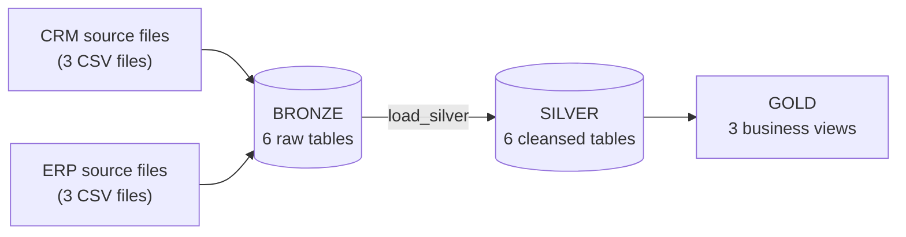

# Enterprise Data Warehouse

An end-to-end data warehouse built on **Microsoft SQL Server** that integrates **CRM** and **ERP** source data using the **Medallion Architecture** (Bronze → Silver → Gold). Raw CSV files are loaded as-is, cleaned and standardized in a second layer, and exposed as analysis-ready views in the final layer.

---

## Table of Contents

1. [Project Overview](#project-overview)
2. [Architecture](#architecture)
3. [Tech Stack](#tech-stack)
4. [Repository Structure](#repository-structure)
5. [Source Data](#source-data)
6. [Bronze Layer](#bronze-layer)
7. [Silver Layer](#silver-layer)
8. [Gold Layer](#gold-layer)
9. [Monitoring and Error Handling](#monitoring-and-error-handling)
10. [Indexing](#indexing)
11. [How to Run](#how-to-run)
12. [Design Notes and Limitations](#design-notes-and-limitations)
13. [Author](#author)
14. [License](#license)

---

## Project Overview

Businesses often keep customer, product and sales data in separate systems. This project brings two of them together:

- **CRM** system: customers, products and sales transactions
- **ERP** system: customer demographics, customer locations and product categories

The warehouse follows a three-layer design. Each layer has one job:

| Layer | Purpose | Data state |
|-------|---------|------------|
| **Bronze** | Ingest source files without changing them | Raw, as received |
| **Silver** | Clean, standardize and validate | Cleansed and consistent |
| **Gold** | Join and present business-ready data | Views for reporting and analysis |

**Key features**

- Full-load batch pipeline: truncate and reload using `BULK INSERT`
- Stored procedures for the Bronze and Silver loads
- Data cleansing rules: date conversion, value standardization, derived keys, outlier handling, control-character removal
- Per-table and total load timing
- `TRY...CATCH` error reporting in the Bronze load
- Audit column `dwh_update_date` on every Silver table
- Clustered and non-clustered indexes on Silver tables
- Gold layer delivered as three views that join CRM and ERP data

---

## Architecture



**Load flow**

1. `proc_load_bronze` truncates each Bronze table and bulk-loads the matching CSV file.
2. `load_silver` truncates each Silver table and inserts transformed data from Bronze.
3. Gold views read from Silver at query time. They store no data of their own.

---

## Tech Stack

| Component | Technology |
|-----------|------------|
| Database | Microsoft SQL Server |
| Language | T-SQL |
| Ingestion | `BULK INSERT` from CSV files |
| Automation | Stored procedures |
| Version control | Git and GitHub |

---

## Repository Structure

```
enterprise-data-warehouse/
├── Data_set/      # Source CSV files (CRM and ERP)
├── Docs/          # Project documentation
├── Scripts/       # SQL scripts for every layer
├── LICENSE        # MIT License
└── README.md
```

**Scripts overview**

| Script | Layer | What it does |
|--------|-------|--------------|
| `init_database.sql` | Setup | Drops and recreates the `Data_Warehouse` database. Creates the `bronze`, `silver` and `gold` schemas. |
| `ddl_bronze.sql` | Bronze | Drops and recreates the 6 Bronze tables. |
| `proc_load_bronze.sql` | Bronze | Creates and runs `proc_load_bronze` (truncate + bulk load, with timing and error handling). |
| `ddl_silver.sql` | Silver | Drops and recreates the 6 Silver tables, each with a `dwh_update_date` audit column. |
| `silver_index.sql` | Silver | Creates clustered and non-clustered indexes. |
| `proc_load_silver.sql` | Silver | Creates and runs `load_silver` (cleansing, standardization and load, with timing). |
| `vw_gold1.sql` | Gold | Creates the three Gold views. |

---

## Source Data

Six CSV files from two source systems feed the Bronze layer.

| Source system | File | Bronze table | Content |
|---------------|------|--------------|---------|
| CRM | `cust_info.csv` | `bronze.crm_cust_info` | Customer ID, key, name, marital status, gender, creation date |
| CRM | `prd_info.csv` | `bronze.crm_prd_info` | Product ID, key, name, cost, product line, start and end dates |
| CRM | `sales_details.csv` | `bronze.crm_sales_detail` | Order number, product key, customer ID, order/ship/due dates, sales, quantity, price |
| ERP | `CUST_AZ12.csv` | `bronze.erp_cust_info` | Customer ID, birth date, gender |
| ERP | `LOC_A101.csv` | `bronze.erp_cust_loc` | Customer ID, country |
| ERP | `PX_CAT_G1V2.csv` | `bronze.erp_prd_info` | Category ID, category, subcategory, maintenance flag |

---

## Bronze Layer

**Goal:** a faithful copy of the source. No cleaning happens here, so any issue can be traced back to the original file.

**Design**

- One table per source file (6 tables), created by `ddl_bronze.sql`
- Column names and values stay as they appear in the source
- Order, ship and due dates in `crm_sales_detail` are stored as integers, exactly as the source provides them

**Load procedure: `proc_load_bronze`**

For each of the six tables, the procedure:

1. Truncates the table
2. Runs `BULK INSERT` from the matching CSV (`FIRSTROW = 2`, comma delimiter, `0x0a` row terminator, `TABLOCK`)
3. Measures and prints the load time

It also prints the total run time and reports the error message, error number and error line if a load fails.

---

## Silver Layer

**Goal:** consistent, trustworthy data. Every Silver table has the same structure as its Bronze source (with a few derived columns) plus a `dwh_update_date` column that records when the row was loaded.

**Load procedure: `load_silver`**

For each table, the procedure truncates the target and inserts the transformed Bronze data.

### Transformation rules

| Table | Rules applied |
|-------|---------------|
| `silver.crm_sales_detail` | Converts integer dates (`YYYYMMDD`) to `DATE`. Invalid values (wrong length) become `NULL`. Recalculates `sales` as `quantity × price` when the source value is inconsistent. Derives `price` from `sales ÷ quantity` when price is zero or negative. Uses `NULLIF` to prevent divide-by-zero. |
| `silver.crm_cust_info` | Derives a missing customer ID from the customer key. Trims first and last names. Expands marital status (`M` → `MARRIED`, `S` → `SINGLE`) and gender (`M` → `MALE`, `F` → `FEMALE`). Replaces missing values with `N/A`. |
| `silver.crm_prd_info` | Derives `cat_key` from the first five characters of the product key (hyphen replaced by underscore). Expands product line codes (`M` → `MOUNTAIN`, `R` → `ROAD`, `S` → `OTHER SALES`, `T` → `TOURING`, otherwise `N/A`). Calculates the end date with `LEAD()` over each product's start dates (next start date minus one day). Keeps only the current record of each product (rows with no later start date). |
| `silver.erp_cust_info` | Derives `cst_key` from the customer ID so ERP rows can join to CRM rows. Replaces future birth dates with `NULL`. Standardizes gender labels and replaces blanks with `N/A`. |
| `silver.erp_cust_loc` | Removes hyphens from customer IDs. Removes tab, line-feed and carriage-return characters and replaces non-breaking spaces. Maps `DE` → `Germany` and `US` / `USA` → `United States`. Replaces blank countries with `N/A`. |
| `silver.erp_prd_info` | Removes tab, line-feed and carriage-return characters from the maintenance flag. Trims whitespace and converts to upper case. |

---

## Gold Layer

**Goal:** business-ready data. The Gold layer is built as **three views** over Silver, so the data is always current after a Silver load and takes no extra storage.

### `gold.vw_cst_detail`: customer view

Combines CRM customer records with ERP birth date and country.

| Column | Description |
|--------|-------------|
| Row number | Generated sequence over the customer key |
| `Customer_ID` | CRM customer ID |
| `Customer_Key` | CRM customer key |
| `First_Name`, `Last_Name` | Customer name |
| `Birth_Date` | From ERP customer data |
| `Country` | From ERP location data |
| `Gender` | CRM gender |
| `Marital_Status` | CRM marital status |
| `Update_Date` | CRM creation date |

**Joins:** `silver.crm_cust_info` LEFT JOIN `silver.erp_cust_info` (on customer key) LEFT JOIN `silver.erp_cust_loc` (on customer key).

### `gold.vw_prd_info`: product view

Combines CRM product records with ERP category data.

| Column | Description |
|--------|-------------|
| `product_id`, `product_key`, `category_key` | Product identifiers |
| `product_name`, `product_cost`, `product_line` | Product attributes |
| `product_category`, `product_subcategory`, `MAINTENANCE` | From ERP category data |
| `start_date`, `end_date` | Product validity dates |

**Join:** `silver.crm_prd_info` LEFT JOIN `silver.erp_prd_info` (on `category_key`).

### `gold.vw_sales_info`: sales view

Exposes cleansed sales transactions from `silver.crm_sales_detail`.

| Column | Description |
|--------|-------------|
| `Order_number` | Order identifier |
| `Product_key` | Product identifier |
| `customer_id` | Links to `Customer_ID` in the customer view |
| `order_date`, `ship_date`, `due_date` | Transaction dates |
| `Sales`, `Quantity`, `Price` | Cleansed sales measures |

---

## Monitoring and Error Handling

- **Timing:** both load procedures print the duration of each table load and the total run time.
- **Error reporting:** `proc_load_bronze` wraps the load in `TRY...CATCH` and prints the error message, number and line.
- **Audit trail:** every Silver row carries `dwh_update_date` (default `SYSDATETIME()`).

---

## Indexing

`silver_index.sql` creates:

- A **clustered index** on the business key of each Silver table
- A **non-clustered index** on `silver.crm_prd_info (cat_key)` to support the join to ERP category data in the product view

---

## How to Run

**Prerequisites:** Microsoft SQL Server, a SQL client to run T-SQL, and the six source CSV files.

1. **Clone the repository**
   ```bash
   git clone https://github.com/20ayush09/enterprise-data-warehouse.git
   ```
2. **Place the CSV files** in `Data_set/source_crm` and `Data_set/source_erp`.
3. **Update the file paths** in `proc_load_bronze.sql`. The `BULK INSERT` paths point to a local folder and must match your machine. The SQL Server service account must be able to read them.
4. **Run the scripts in this order:**

   | Step | Script |
   |------|--------|
   | 1 | `init_database.sql` |
   | 2 | `ddl_bronze.sql` |
   | 3 | `ddl_silver.sql` |
   | 4 | `silver_index.sql` |
   | 5 | `proc_load_bronze.sql` |
   | 6 | `proc_load_silver.sql` |
   | 7 | `vw_gold1.sql` |

5. **Query the Gold layer**
   ```sql
   SELECT TOP 10 * FROM gold.vw_cst_detail;
   SELECT TOP 10 * FROM gold.vw_prd_info;
   SELECT TOP 10 * FROM gold.vw_sales_info;
   ```

> **Warning:** `init_database.sql` and the DDL scripts permanently delete existing objects. Use them only in a development or test environment.

---

## Design Notes and Limitations

- **Full load only.** Each run truncates and reloads every table. There is no incremental loading.
- **No transaction wrapper.** If a load fails after a table is truncated, that table can stay empty or partly loaded. Re-run the procedure after fixing the cause.
- **Silver load has no `TRY...CATCH`.** Only the Bronze load reports errors in a structured way.
- **Timing precision.** Durations are reported in whole seconds, so fast loads can show `0`.
- **Product history.** The Silver product table keeps only the current record of each product.

---

## Author

**Ayush Agarwal**: ACCA and MA Economics student building a finance and data analytics portfolio.

- LinkedIn: [ayush-agarwal](https://www.linkedin.com/in/ayush-agarwal-9270672bb/)
- GitHub: [@20ayush09](https://github.com/20ayush09)

## License

This project is licensed under the [MIT License](LICENSE).
